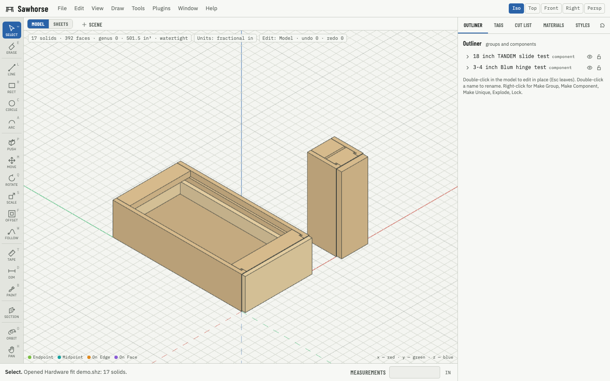

# Small slide and hinge fit model

Open **18-inch-slides-and-3-4-inch-door.shz** in Sawhorse. The two named assemblies are separate hardware test rigs, with 17 solid parts in total. This is a fit test, not a load-rated desk drawer.

| Test rig | Width × box depth × height | Hardware modeled |
|---|---|---|
| Drawer | 10 × 19 × 4¾ in | Blum TANDEM 563H4570B, nominal 18 in / 457 mm, with T51.1901 left/right locking devices |
| Door | 4 × 4¼ × 11¼ in | Two Blum CLIP top BLUMOTION 71B3550 full-overlay hinges and two 173L8100 zero-height mounting plates |

The carcasses and hinged door are **actual ¾ in** stock. The drawer face and box are **actual ½ in**. Its bottom is **actual ¼ in**. The small rigs omit cabinet backs, toe kicks, pulls and edge banding to save material. Full cabinets can use the planned ¼ in backing. These dimensions assume the listed hardware; another undermount slide family needs its own box, setback and holes.

The drawer uses the existing mini-drawer planner's minimum width and height, with a 19 in carcass depth for the 457 mm runner's 480 mm minimum inside depth. The narrow hinged door has 35 × 13 mm cup recesses, 6.5 mm boring distance, and 3½ in hinge inset from each end. Its hinges are farther apart than the door is wide. The reveal is 1/16 in per edge; the overlay is 11/16 in, rather than a claim of ¾ in overlay. Both rigs use ¼ in blind dados and 0.008 in fit clearance. Measure the actual plywood and cut a joint-clearance coupon before using these dimensions on different stock.

The model nests on these three small scraps, including a ⅜ in gap for the router and ¼ in edge trim:

| Actual thickness | Scrap rectangle | Use |
|---|---|---|
| ¾ in | 22½ × 30 in | Carcasses and hinged door |
| ½ in | 11 × 19 in | Drawer front and box |
| ¼ in | 8½ × 18½ in | Drawer bottom |

The parts use **5.813 sq ft net**, from **7.231 sq ft** of scraps. The script tries rectangles on a ½ in grid, up to 24 × 48 in, in increasing area, and takes the first one the nester fits per thickness. This is the smallest result found on that grid by this nester, not proof of an optimal packing. The plain test plywood has no grain restriction. `cut-list.csv` lists each blank; `settings-and-checks.json` records the settings, hardware and operation notes.

Open **Cut list > Nesting**, then **CNC setup** to assign and confirm the cutters you actually have. **CNC files** exports DXF for VCarve or Carbide Create. The 5 mm and 6 mm holes need a smaller suitable end mill with enough cutting length, using pocket toolpaths. The 35 mm cups are pockets too. Set the CAM stock thickness from the measured scrap, inspect every toolpath and check hold-down for these small parts. The locking devices' angled pilot holes and the rear-hook drilling called out in the operation notes require the appropriate hand/template setup; a top-down DXF cannot describe every drilling direction. Assemble and brace the small open-backed carcasses square before testing the hardware.

Regenerate from the repository root with `npm run wasm` followed by `node scripts/make-hardware-demo.mjs`. The script checks planner warnings, counted solid parts, one scrap per thickness, no unplaced parts, and a save/open hash round trip before writing the files.
